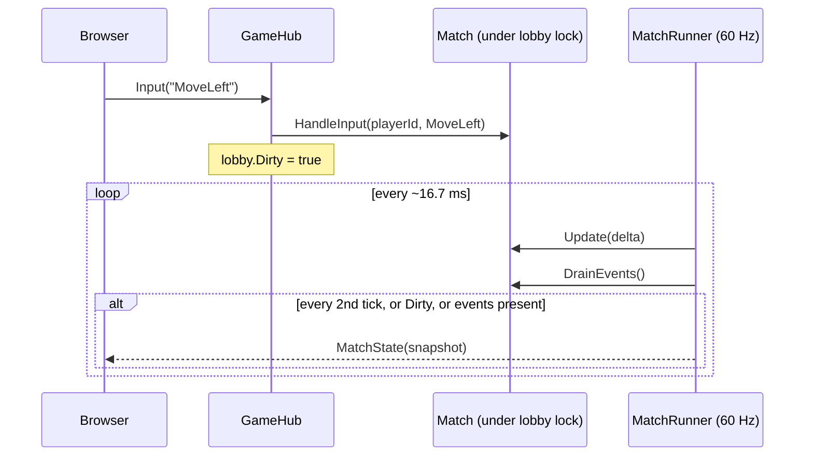

# Architecture

## Overview

```mermaid
flowchart LR
    subgraph Browser
        UI[React app<br/>pages + canvas rendering]
        KB[Keyboard input<br/>DAS / ARR]
        HC[HubClient<br/>@microsoft/signalr]
        KB --> HC
        HC --> UI
    end

    subgraph Proxy[Reverse proxy - existing]
    end

    subgraph WebsiteContainer[actionblocks-website - nginx]
        Static[index.html, JS, CSS,<br/>assets, config.js]
    end

    subgraph ServerContainer[actionblocks-server - ASP.NET Core]
        Hub[GameHub]
        LM[LobbyManager]
        MR[MatchRunner<br/>60 Hz loop]
        GL[ActionBlocks.Game<br/>Match / PlayerGame]
        Hub --> LM
        MR --> LM
        LM --> GL
        MR --> GL
    end

    Browser -- HTTPS --> Proxy
    Proxy -- static files --> WebsiteContainer
    Proxy -- WebSocket /hub --> ServerContainer
```

The **website container** only serves static files. All game communication goes from the browser straight to the **game server**, through the reverse proxy, over a SignalR WebSocket connection. The two containers never talk to each other. Each one sits in its own Docker network (`actionBlocks_website` and `actionBlocks_server`), and both networks are attached to the reverse proxy.

## Server-authoritative design

The server owns the complete game state. The browser never simulates the game. It only:

1. sends **input commands** (`MoveLeft`, `HardDrop`, `UseItem`, …), and
2. **renders** the snapshots it receives.



**Why this approach:**

- **One source of truth.** Interactions between players (garbage, item effects, board swaps) are resolved in one place. Nothing ever needs to be reconciled.
- **Cheating is mostly impossible.** Clients cannot fake line clears, items or piece positions.
- **Game logic is easy to change.** All rules live in one C# library with unit tests.

**Trade-off:** input feels as responsive as the network round trip allows. There is no client-side prediction. On a LAN or a good connection (< 50 ms) this is fine. For high-latency play, the natural next step would be local prediction of the player's own active piece. See [Known limitations](#known-limitations).

To keep the feel responsive anyway:

- **Auto-repeat on the client.** Delayed auto shift (DAS) and the auto-repeat rate (ARR) for held left/right keys run in the browser. The browser sends discrete `MoveLeft` / `MoveRight` commands at the repeat rate.
- **Extra snapshot after input.** Any input marks the lobby *dirty*. The next tick (≤ 16.7 ms later) then always sends a snapshot, even when it isn't a regular broadcast tick.

## Server internals at a glance

The C# solution separates **game rules** from **hosting**:

| Project | Depends on | Contains |
|---|---|---|
| `ActionBlocks.Game` | nothing (plain .NET) | Board, pieces, rotation system, randomizer, `PlayerGame`, `Match`, garbage, items, targeting |
| `ActionBlocks.Server` | `ActionBlocks.Game`, ASP.NET Core | SignalR hub, lobbies, tick loop, network DTOs |
| `ActionBlocks.Game.Tests` | `ActionBlocks.Game`, xUnit | Unit tests |

Because `ActionBlocks.Game` knows nothing about networking, it can be unit tested in isolation and reused, for example for bots or a different transport.

Rules are modular through interfaces. Swap an implementation to change a rule without touching the rest:

| Interface | Default implementation | Decides |
|---|---|---|
| `IRotationSystem` | `SuperRotationSystem` | How pieces rotate and kick off walls/floor |
| `IRandomizer` | `SevenBagRandomizer` | The piece sequence |
| `IGarbageCalculator` | `StandardGarbageCalculator` | How many lines an attack sends |
| `IScoreCalculator` | `StandardScoreCalculator` | Points per clear |
| `IGarbageTargeter` | `CyclingGarbageTargeter` | Who receives garbage |
| `IItem` | 5 item classes | What an item does |

Numeric rules (board size, lock delay, item chance, …) live in the `GameSettings` record. They can be overridden through configuration without recompiling.

## Concurrency model

- `LobbyManager` stores lobbies in a `ConcurrentDictionary`.
- Each `Lobby` has a `Sync` object. **Every access to a lobby and its `Match` happens inside `lock (lobby.Sync)`**: hub calls (input, join, leave, start) and the tick loop.
- `Match` and `PlayerGame` are deliberately **not thread-safe**. They rely on the lobby lock.
- A single background service, `MatchRunner`, ticks all lobbies sequentially at 60 Hz. Network sends happen **outside** the lock and are fire-and-forget, so a slow client never blocks the game loop.

## State lifetime

All state is **in memory**: there is no database. If the server process restarts, every lobby and match is lost. If a player's connection drops, they are removed from their lobby and forfeit any running match. Reconnecting creates a new connection, so the player has to join again.

## Known limitations

These are conscious simplifications. They are good candidates for future work:

| Limitation | Impact | Possible improvement |
|---|---|---|
| No client-side prediction | Movement latency equals the network round trip | Predict the own active piece locally and reconcile with snapshots |
| Full JSON snapshots of all players at ~30–60 Hz | About 1.5 KB per snapshot for 2 players. It grows linearly with players | Send deltas, or use the MessagePack protocol, or send opponents at a lower rate |
| Blackout (invisibility) is hidden client-side | A modified client could still show the board | Strip the board from that player's personal snapshot on the server |
| No reconnect into a running lobby | A network hiccup kicks the player | Issue a session token and re-bind to the player on reconnect |
| In-memory lobbies, single server instance | No horizontal scaling | Use a SignalR backplane plus external state, or sticky sessions per lobby |
| Max 8 players per lobby | Matches the number keys 1–9 (1 = self) | Raise `Lobby.MaxPlayers`; the UI would need paging for targets |
