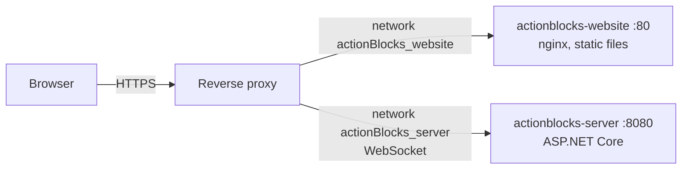

# Deployment

Both components ship as Docker images and run together through `docker-compose.yml`. An already existing **reverse proxy** handles TLS and routing. Compose therefore publishes no ports.

## Topology



| Container | Image built from | Port | Docker network |
|---|---|---|---|
| `actionblocks-website` | `actionBlocks_website/Dockerfile` | 80 | `actionBlocks_website` (external) |
| `actionblocks-server` | `actionBlocks_server/Dockerfile` | 8080 | `actionBlocks_server` (external) |

Both networks are declared `external: true`. They must exist beforehand and be attached to the proxy:

```bash
docker network create actionBlocks_website
docker network create actionBlocks_server
```

## Images

### Server (`actionBlocks_server/Dockerfile`)

1. `mcr.microsoft.com/dotnet/sdk:10.0` restores the packages, **runs the unit tests** (a failing test fails the build), then publishes in Release mode.
2. `mcr.microsoft.com/dotnet/aspnet:10.0` runs `dotnet ActionBlocks.Server.dll` as the non-root `$APP_UID` user on port 8080.

### Website (`actionBlocks_website/Dockerfile`)

1. `node:22-alpine` runs `npm ci && npm run build` (typecheck + Vite build into `dist/`).
2. `nginx:1.27-alpine` serves `dist/` with `docker/nginx.conf`.
3. `docker/40-runtime-config.sh` is placed in `/docker-entrypoint.d/`. The official nginx image runs that directory's scripts at **every container start**. The script writes `config.js` from the `SERVER_URL` env var, so the same image works in any environment without a rebuild.

nginx behaviour (`docker/nginx.conf`):

| Path | Behaviour |
|---|---|
| `/static/…` | Hashed bundles, cached for a year (`immutable`) |
| `/assets/…` | Exchangeable graphics, `no-cache` (revalidated, so replaced files appear immediately) |
| `/config.js`, `/index.html` | Never cached |
| anything else | File if it exists. Otherwise the first path segment is stripped and the lookup retried (this supports proxies that do not strip a sub-path). Finally falls back to `index.html` |

## Configuration

Compose reads a `.env` file next to `docker-compose.yml`. Copy the template and edit it:

```bash
cp .env.example .env
```

| Variable | Used by | Default | Description |
|---|---|---|---|
| `SERVER_URL` | website | empty → `<site origin>/hub` | Full hub URL **as the browser sees it**, e.g. `https://game.example.com/server/hub` |
| `ALLOWED_ORIGINS` | server | empty → any origin | Comma-separated list of origins allowed to connect, e.g. `https://game.example.com` |
| `PATH_BASE` | server | empty | Prefix to accept if the proxy forwards a sub-path **without stripping it**, e.g. `/server` |
| `HUB_PATH` | server | `/hub` | Hub endpoint path. It is fixed to `/hub` in the compose file |
| `ITEM_SPAWN_CHANCE` | server | `0.1` | Chance (0..1) that each block of a new piece carries an item. Passed to the server as `Game__ItemSpawnChance` |
| `Game__<Setting>` | server | see `GameSettings.cs` | Overrides other gameplay values, e.g. `Game__CountdownSeconds=5`. Add these under the server's `environment:` in the compose file |

Start or update:

```bash
docker compose up -d --build
```

Verify:

```bash
docker exec actionblocks-website cat /usr/share/nginx/html/config.js   # shows SERVER_URL
curl https://<your-host>/<server-path>/health                             # {"status":"ok"} (the server image has no curl/wget, so test through the proxy)
```

## Reverse proxy requirements

1. Route the website to `actionblocks-website:80`.
2. Route the hub to `actionblocks-server:8080`, with **WebSocket upgrade** support. The `Upgrade` and `Connection` headers must be forwarded, and read timeouts must be long because the connection stays open for the whole session.
3. If the hub runs on a different origin than the site, list the site's origin in `ALLOWED_ORIGINS`.

### Sub-paths

Serving under paths such as `https://game.example.com/website/` and `/server/` is supported:

- **Website:** works whether the proxy strips `/website` or not. All URLs in the build are relative, and nginx retries unknown paths without their first segment.
- **Server:**
  - If the proxy strips `/server`, nothing else is needed. The hub answers at `/hub`.
  - If it does not strip the prefix, set `PATH_BASE=/server`.
- Set `SERVER_URL` to the public hub URL, e.g. `https://game.example.com/server/hub`.

### Example: nginx as the reverse proxy

```nginx
# Website under /website/ (prefix stripped by the trailing slash in proxy_pass)
location /website/ {
    proxy_pass http://actionblocks-website:80/;
}

# Game server under /server/ (prefix stripped)
location /server/ {
    proxy_pass http://actionblocks-server:8080/;
    proxy_http_version 1.1;
    proxy_set_header Upgrade $http_upgrade;
    proxy_set_header Connection "upgrade";
    proxy_set_header Host $host;
    proxy_read_timeout 3600s;
}
```

Matching `.env`:

```env
SERVER_URL=https://game.example.com/server/hub
ALLOWED_ORIGINS=https://game.example.com
PATH_BASE=
```

## Troubleshooting

| Symptom | Likely cause | Fix |
|---|---|---|
| Browser console: `Refused to apply style … MIME type ('')`, 404 for `config.js` / `index-*.js` | Assets requested from the wrong path, e.g. an old image built with absolute URLs, or the proxy doesn't route the sub-path | Rebuild the website image, check the proxy route |
| Red banner "Server unreachable, retrying..." | `SERVER_URL` wrong, hub not routed, or WebSocket upgrade blocked | Open `<SERVER_URL>/negotiate?negotiateVersion=1` with a POST (e.g. `curl -X POST`); it must return JSON. Check the upgrade headers on the proxy |
| CORS error in the console | Site origin not in `ALLOWED_ORIGINS` | Add the exact origin (scheme + host + port) |
| Works, then players are kicked after ~60 s idle | Proxy read timeout too short | Raise the proxy's timeout for the hub route |
| Changed `.env` has no effect | Containers not recreated | `docker compose up -d` (recreates containers with new env) |
| All lobbies vanish | Server container restarted | Expected: state is in memory only |
