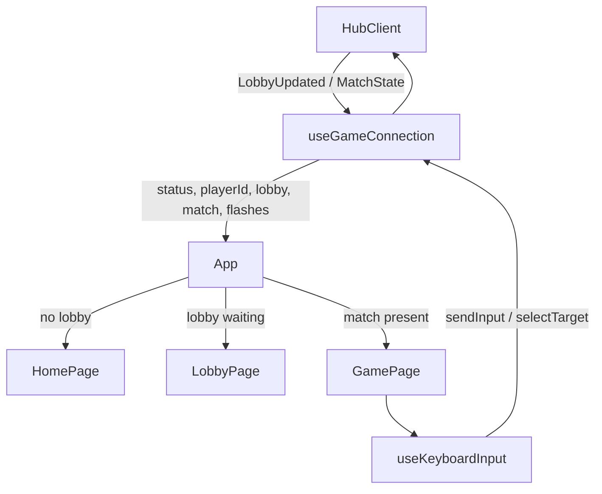

# Frontend (`actionBlocks_website/`)

React 19 + TypeScript, bundled with Vite. Styling uses **CSS Modules only**: every component has a `*.module.css` next to it. The only global stylesheet is `src/theme/global.css`, which holds design tokens and the base reset. The game boards are drawn on `<canvas>`.

```
actionBlocks_website/
├── index.html                 # trailing-slash redirect, loads config.js and the app
├── vite.config.ts             # base './', output dir 'static', dev proxy for /hub
├── public/                    # copied to the build output unchanged
│   ├── config.js              # runtime config (overwritten in the container)
│   └── assets/                # exchangeable graphics
│       ├── favicon.svg
│       ├── items/*.svg        # one icon per item id (+ unknown.svg)
│       ├── ui/                # UI icons (sound menu)
│       └── sounds/            # optional audio files (+ music/)
├── docker/
│   ├── nginx.conf
│   └── 40-runtime-config.sh   # writes config.js from env SERVER_URL
└── src/
    ├── main.tsx               # entry: preload assets, render <App/>
    ├── App.tsx                # top-level screen switch
    ├── config/
    │   ├── runtimeConfig.ts   # resolves the hub URL
    │   └── keybindings.ts     # all key bindings, DAS/ARR timings, help texts
    ├── net/
    │   ├── types.ts           # TypeScript mirror of the server DTOs
    │   ├── hubClient.ts       # typed SignalR wrapper
    │   └── useGameConnection.ts  # React hook: connection + all server state
    ├── input/useKeyboardInput.ts # keyboard → game actions (with DAS/ARR)
    ├── audio/                 # sound effects + music (see "Audio" below)
    ├── render/
    │   ├── draw.ts            # canvas drawing: blocks, items, ghost, board, previews
    │   └── shapes.ts          # piece shapes for previews
    ├── theme/
    │   ├── global.css         # CSS variables (colors, font), base styles
    │   ├── colors.ts          # block colors used on canvas
    │   └── assets.ts          # registry of every graphic + item visuals
    ├── pages/                 # HomePage, LobbyPage, GamePage (+ .module.css)
    └── components/            # BoardCanvas, MiniBoard, PiecePreview, ItemBar,
                               # ItemFlashOverlay, Logo, CornerControls, SoundMenu, MusicTracks, ui/Button, ui/Panel
```

## Data flow



The app has **no router and no global store**. All server-derived state lives in a single hook, `useGameConnection`. `App` picks the screen from that state:

| State | Screen |
|---|---|
| no lobby or no player id | `HomePage`: enter a name, create a lobby or join one by code |
| `match` present | `GamePage` |
| lobby `phase === 'playing'` but no snapshot yet | "Starting..." placeholder |
| otherwise | `LobbyPage`: code, invite link, players, Start (host), last results, controls and item help |

### `useGameConnection` (`src/net/useGameConnection.ts`)

- Creates one `HubClient` on mount and starts it. If the connection fails it retries every 2 s.
- Keeps `status`, `playerId`, `lobby`, `match` and `flashes` in React state.
- On `LobbyUpdated`, it stores the lobby. When the phase is `waiting`, it also clears `match`, which returns the UI to the lobby screen.
- On `MatchState`, it stores the snapshot. Every `itemUsed` event becomes an **`ItemFlash`** `{ key, targetId, text, color }`, which is removed again after 1.4 s.
- When the connection is lost it clears lobby, match and player id. The server has removed the player by then (see [Architecture](architecture.md#state-lifetime)).
- It exposes stable action callbacks: `createLobby`, `joinLobby`, `leaveLobby`, `startGame`, `sendInput`, `selectTarget`.

### `HubClient` (`src/net/hubClient.ts`)

A thin wrapper around `@microsoft/signalr`:

- Request/response methods (`createLobby`, `joinLobby`, `leaveLobby`, `startGame`) use `invoke`. They turn server errors into a plain `Error` carrying the `HubException` message.
- Streaming input (`input`, `selectTarget`) uses `send`, which is fire-and-forget. These calls are dropped while disconnected.

In development, React StrictMode mounts the hook twice. The first connection is stopped while negotiating, and the console logs `Failed to start the connection: … stopped during negotiation`. This is harmless and does not happen in production builds.

## The game screen (`src/pages/GamePage.tsx`)

Layout: **hold + stats + "1 YOU"**, then the **own board** with the garbage meter and the inventory bar below it, then the **next queue**. To the right is a wrapping grid of **opponent mini boards**.

- **Own entry.** `me = match.players.find(p => p.id === playerId)`. If it is missing, the player joined mid-match and the page shows a "SPECTATING" box plus all boards as minis.
- **Sizes.** The own board's cell size comes from the window height: `clamp(16, (innerHeight - 170) / 20, 32)` px. Mini boards use 14/12/9 px for ≤ 2, ≤ 4 and more opponents.
- **Target selection.**
  - The selected target lives in local state, `targetId`. Slot `1` is yourself and slot `n ≥ 2` is `opponents[n-2]`, in match order excluding yourself.
  - A key press updates the local state and calls `selectTarget` on the server.
  - If the target dies, an effect resets it to yourself, which mirrors the server rule. The selected board gets a cyan frame, and its slot number is filled cyan.
- **Leave.** The Leave button in the corner calls `leaveLobby`. While you are still alive in a match, leaving gives up that match, so the first click only turns the button into a red `SURE?` for 3 s and a second click leaves. After you are out, or once the match has finished, one click is enough. No browser dialog is used, because dialogs block the page.
- **Overlays on the own board:** `ItemFlashOverlay` (flashes whose `targetId` is you), the countdown number, and "YOU WIN!" or "<name> WINS".
- **Blackout.** `hideStack={me.invisibleRemaining > 0}` makes `drawBoard` skip locked cells, item icons and the ghost. `EffectTimers` shows the seconds left on Blackout and Transformation in the board corner.
- **Garbage meter.** A red bar whose height is `pendingGarbage × cell`.
- **Inventory bar.** 10 slots, with the oldest item outlined, plus the hint line `F: <next item> > <target>`.
- **Mini boards.** `MiniBoard` is memoized. It shows the slot number, the name, the board, a flash overlay and the opponent's **item bar beneath the board**.

## Keyboard input (`src/input/useKeyboardInput.ts`)

- Bindings come from `config/keybindings.ts` and are matched on `KeyboardEvent.code` (physical keys).
- Only active while `enabled` (the player is alive and the match is not finished). Key events coming from `<input>` and `<textarea>` are ignored.
- **Left/right** sends one move immediately. After `DAS_MS` (167 ms) it repeats every `ARR_MS` (33 ms). Held directions form a stack, so releasing one resumes the other.
- **Soft drop** counts held soft-drop keys. It sends `SoftDropStart` on the first press and `SoftDropStop` when the last one is released.
- **Number keys** call `onTarget(slot)`.
- Browser key-repeat events are ignored. `preventDefault` stops arrows and space from scrolling the page.
- On window **blur** every held key is released, which also stops a running soft drop.

## Rendering (`src/render/draw.ts`)

All drawing is plain Canvas 2D in a pixel style:

- `setupCanvas` sizes the canvas for `devicePixelRatio` and disables image smoothing.
- `drawBlock` draws one block: a base color with a lighter top/left edge and a darker bottom/right edge. **Change this function to change the block look everywhere.**
- `drawItemIcon` draws the item's SVG (from `assets.ts`) over a cell. While the image is still loading it falls back to a colored square.
- `drawBoard` draws, in order: background, grid lines (only when cells are ≥ 14 px), locked cells and item icons (skipped when `hideStack`), the ghost (semi-transparent outline), and the active piece with its item icon.
- `drawPreviewPiece` draws hold and next pieces centered in a box, using the shapes from `render/shapes.ts`.

`BoardCanvas` redraws in an effect whenever its `state` prop changes, i.e. on every snapshot. It also renders the "OUT"/place overlay for eliminated players and any children as overlays.

## Theming and graphics

Everything visual can be swapped without touching component logic:

| What | Where |
|---|---|
| UI colors, font, border style | CSS variables in `src/theme/global.css` (`--color-*`, `--font-pixel`, `--border`) |
| Block colors (1–7 pieces, 8 garbage), grid, ghost alpha | `src/theme/colors.ts` |
| Item icons, names, flash colors, help texts | `itemVisuals` in `src/theme/assets.ts` |
| Image files | `public/assets/…`, referenced only from `assets.ts` |
| Logo | `uiAssets.logo` in `assets.ts`. `null` renders the colored text logo |
| Block drawing style | `drawBlock` in `src/render/draw.ts` |
| Font | Google Fonts link in `index.html` plus `--font-pixel` |

The pixel font (*Press Start 2P*) has **no arrow, ellipsis or dash glyphs**, so UI text uses ASCII only ("LEFT RIGHT", "...", "-", ">").

Asset paths go through the `asset()` helper in `assets.ts` (`import.meta.env.BASE_URL + path`), so they stay correct when the site is served under a sub-path.

## Audio (`src/audio/`)

All sound is generated in the browser with the **Web Audio API**: oscillators (square, triangle, sawtooth) and filtered noise with short volume envelopes, in the style of old console sound chips. No audio files are needed, but any effect or music track can be replaced by a file.

| File | Role |
|---|---|
| `../config/sound.ts` | **Central volume mix for developers**: master, sfx, music, per effect, per track, default slider positions |
| `types.ts` | `SoundId` (all effects), `SoundPlayer` (the interface the UI talks to), `MusicTrack`, `SynthSong`, `SoundSettings` |
| `synthSounds.ts` | One recipe per `SoundId`, plus the `tone()` / `noise()` helpers |
| `music.ts` | `SynthSongPlayer`: plays a `SynthSong` with a lookahead scheduler on the audio clock |
| `songs.ts` | The three built-in songs, written as text patterns |
| `MusicPlaylist.ts` | Plays the registered tracks in shuffled order. Each track plays once before the order is reshuffled. File tracks advance when they end, synth songs after `loops` repetitions |
| `AudioEngine.ts` | `WebAudioPlayer implements SoundPlayer`: owns the `AudioContext`, the SFX and music volume nodes, file loading with fallback to the synth, and a 30 ms per-sound throttle |
| `settings.ts` | `sfxMuted`, `musicMuted`, both volumes and the disabled tracks, saved in `localStorage`. An old single `muted` flag is migrated to both |
| `SoundContext.tsx` | `SoundProvider` (wraps `<App/>` in `main.tsx`) and the `useSound()` / `useCurrentTrack()` hooks. It also handles the global **M** (all sound on/off), **B** (music on/off) and **N** (next track) keys |
| `useGameSounds.ts` | Compares each snapshot with the previous one and plays the matching sounds |

**When sounds play.** Everything comes from data the client already receives, so the server is unchanged. Snapshots are server-confirmed, so a blocked move or rotation stays silent.

| Sound | Trigger |
|---|---|
| `countdown`, `go` | Countdown number changes; phase changes to `running` (music starts) |
| `move`, `rotate` | Own active piece moved sideways or changed shape |
| `hold` | `holdUsed` became true |
| `lock` | Next queue advanced without a line clear |
| `hardDrop` | Sent from `GamePage` when the HardDrop input is sent (a hard drop looks like any other lock in the snapshot) |
| `lineClear` (pitch rises per line), `quad` | `lines` increased by 1–3, or by 4 |
| `itemPickup`, `itemUse` | Own inventory grew or shrank |
| `itemHit` | `itemUsed` event targeting you |
| `garbageIncoming` | `pendingGarbage` increased |
| `knockout`, `lose`, `win` | An opponent was eliminated; you were eliminated; you won (music stops when the match finishes) |

The music tempo rises slightly with your level, by 3 % per level and at most 30 %.

**Autoplay.** Browsers block audio until the user interacts with the page. The `AudioContext` is created on the first key press or click, which always happens before a match starts.

**UI.**

- `CornerControls` is fixed in the upper right corner of every screen (16px from the edges): the `SoundMenu` speaker button, and below it a small Leave button in the lobby and the game.
- Clicking the speaker button opens an inline strip to its left, in the header row, so it never covers a board and doesn't pause the game. The strip has a mute button and a volume slider each for `SFX` and `MUSIC`. Moving a muted slider unmutes that channel. Escape, a click outside or the button close the strip. Buttons and sliders give keyboard focus back to the page after use, so game keys keep working.
- The speaker icons are `uiAssets.soundOn` / `soundOff` (`public/assets/ui/`).
- `MusicTracks` lists one checkbox per track in the lobby's "Music" panel.
- The game header shows the current track. While music is muted the playlist doesn't run at all.

**Debugging.** In dev builds every played sound is logged with `console.debug` as `[sound] <id>`, and music changes as `[music] play|stop <track id>`. Enable the "Verbose" level in devtools to see them.

## Runtime configuration

`src/config/runtimeConfig.ts` resolves the hub URL in this order:

1. `window.__ACTIONBLOCKS_CONFIG__.serverUrl` from `config.js`. In Docker this file is generated from `SERVER_URL` at container start.
2. `VITE_SERVER_URL`, read at build time.
3. `<page origin>/hub`.

## Sub-path support

The site can live at `https://host/` or at `https://host/some/path/`:

- `vite.config.ts` sets `base: './'`, so all built URLs are relative (`./static/…`, `./config.js`, `./assets/…`).
- `index.html` starts with a tiny script that redirects `/path` to `/path/`. Without the trailing slash, relative URLs would resolve against the parent directory.
- Hashed bundles go to `static/` (`build.assetsDir`), which keeps them separate from the exchangeable graphics in `assets/`.
