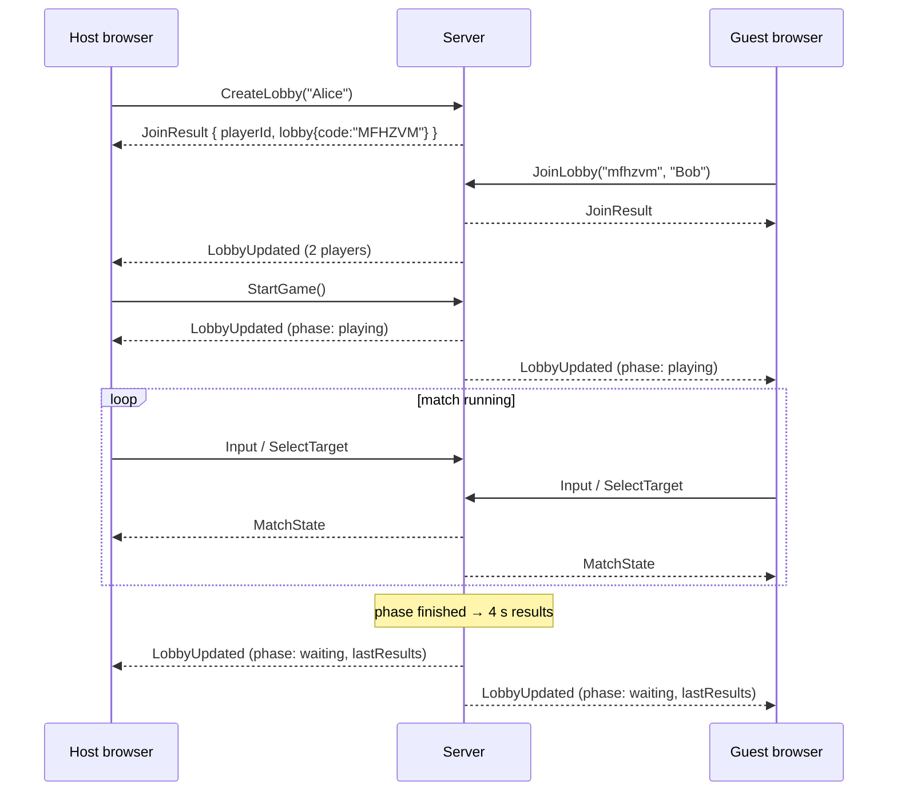

# Client ↔ Server Protocol

Communication uses **ASP.NET Core SignalR** over WebSockets. SignalR falls back to Server-Sent Events or long polling if WebSockets are unavailable. The payload format is JSON with **camelCase** property names. Enums are sent as **strings**.

- Hub URL: `<server>/hub`. The path is configurable through `HUB_PATH`, and the website finds the URL through `SERVER_URL` (see [Deployment](deployment.md)).
- Server implementation: `actionBlocks_server/src/ActionBlocks.Server/Hubs/GameHub.cs`
- DTO definitions: `actionBlocks_server/src/ActionBlocks.Server/Dtos/Dtos.cs`
- Client implementation: `actionBlocks_website/src/net/hubClient.ts`
- Client types (mirror of the DTOs): `actionBlocks_website/src/net/types.ts`

> When you change a DTO on the server, update `types.ts` in the website as well. Nothing generates it automatically.

## Client → server (hub methods)

| Method | Arguments | Returns | Notes |
|---|---|---|---|
| `CreateLobby` | `name: string` | `JoinResult` | Creates a lobby and joins it as host |
| `JoinLobby` | `code: string, name: string` | `JoinResult` | The code is case-insensitive |
| `LeaveLobby` | – | – | Also forfeits a running match |
| `StartGame` | – | – | Host only; fails while a match is running |
| `Input` | `action: InputAction` | – | Sent with `send` (fire-and-forget) |
| `SelectTarget` | `targetId: string` | – | Player id of the item target, or your own id |
| `GetItems` | – | `ItemInfo[]` | Items of the current config: `{ id, name, share, durationSeconds }`. `share` is 0..1 (0 = disabled), `durationSeconds` is null for instant items. The lobby help panel uses it |

`InputAction` is one of `MoveLeft`, `MoveRight`, `RotateCw`, `RotateCcw`, `SoftDropStart`, `SoftDropStop`, `HardDrop`, `Hold`, `UseItem`.

**Soft drop** is a state: the client sends `SoftDropStart` on key down and `SoftDropStop` on key up. Every other action is a single event. Left/right auto-repeat is generated by the client.

### Errors

Failed calls throw a `HubException`. The client receives its message, and `hubClient.ts` extracts the text after `HubException: `. Possible messages:

| Message | Cause |
|---|---|
| `You are already in a lobby.` | `CreateLobby` / `JoinLobby` while already joined |
| `Lobby not found.` | Wrong code, or the lobby was deleted |
| `Lobby is full.` | 8 players already |
| `You are not in a lobby.` | `StartGame` without a lobby |
| `Only the host can start the game.` | `StartGame` from a non-host |
| `A game is already running.` | `StartGame` during a match |

`Input` and `SelectTarget` from a connection that is not in a lobby are silently ignored.

## Server → client messages

| Message | Payload | Sent when |
|---|---|---|
| `LobbyUpdated` | `Lobby` | Another player joined or left, the host changed, a match started (`phase: "playing"`) or a match ended and results are available (`phase: "waiting"`) |
| `MatchState` | `MatchState` | During a match: ≈30 Hz, plus immediately after any input or event, and for 4 s after the match finished |

The player who calls `CreateLobby` / `JoinLobby` gets the lobby as the method's return value. Only the *other* players receive `LobbyUpdated` for that join.

## Lobby flow



## Payloads

### `JoinResult`

```json
{ "playerId": "ade86f694a81", "lobby": { /* Lobby */ } }
```

`playerId` identifies *you* inside this lobby. The client needs it to find its own entry in `MatchState.players`.

### `Lobby`

```json
{
  "code": "MFHZVM",
  "hostId": "ade86f694a81",
  "phase": "waiting",              // "waiting" | "playing"
  "maxPlayers": 8,
  "players": [
    { "id": "ade86f694a81", "name": "Alice", "isHost": true },
    { "id": "3466ff69d433", "name": "Bob",   "isHost": false }
  ],
  "lastResults": [                  // null before the first match
    { "id": "ade86f694a81", "name": "Alice", "place": 1, "score": 1250, "lines": 12 }
  ]
}
```

### `MatchState`

```json
{
  "phase": "running",              // "countdown" | "running" | "finished"
  "countdown": 0,                  // seconds left in the countdown
  "winnerId": null,                // set when finished
  "width": 10,
  "height": 20,                    // visible rows
  "players": [ /* PlayerState, in match order */ ],
  "events": [ /* MatchEvent, only those since the previous snapshot */ ]
}
```

### `PlayerState`

```json
{
  "id": "ade86f694a81",
  "name": "Alice",
  "alive": true,
  "place": null,                   // set when eliminated, and for the winner at the end
  "board": "0000000000…3330000000", // width*height chars, row by row, top to bottom
  "items": [ { "x": 2, "y": 19, "itemId": "nuke" } ],
  "active": {
    "type": 7,
    "cells": [[4,-1],[3,0],[4,0],[5,0]],
    "items": [null, null, "swap", null]  // items[i] is the item in cells[i], null if none
  },
  "ghost": [[4,17],[3,18],[4,18],[5,18]],
  "hold": { "type": 3, "items": [null, null, null, null] },
  "holdUsed": false,
  "next": [ { "type": 4, "items": ["nuke", null, null, "blind"] }, … ],
  "inventory": ["add_line", "blind"],   // oldest first; inventory[0] is used by F
  "score": 1250,
  "lines": 12,
  "level": 2,
  "pendingGarbage": 3,             // incoming lines waiting to rise
  "invisibleRemaining": 0,         // seconds of Blackout left (> 0 = hide stack + ghost)
  "transformedRemaining": 0        // seconds of Transformation left (queue shows odd shapes)
}
```

**Board encoding.** One character per cell: `'0'` is empty, `'1'`–`'7'` are piece colors (I, J, L, O, S, Z, T), `'8'` is garbage, and `'9'`, `':'`, `';'`, `'<'`, `'='` (values 9–13) are the Transformation shapes (Dot, SmallL, U, Plus, W). Decode with `charCode - 48`. Index = `y * width + x`, where y = 0 is the **top visible row**.

**Coordinates.** All `x, y` values are in visible coordinates. Active-piece cells can have **negative y** while the piece is still above the visible area. Clients skip those cells when drawing.

**Piece type numbers** are `PieceType` values: `1=I, 2=J, 3=L, 4=O, 5=S, 6=Z, 7=T`. They double as the color index in `theme/colors.ts`.

For eliminated players, `active` and `ghost` are `null`.

### `MatchEvent`

All events use one flat shape. Fields that don't apply are `null`.

| `type` | Fields | Meaning |
|---|---|---|
| `itemUsed` | `targetId`, `itemId`, `itemName` | An item hit `targetId`. **The user is intentionally not included.** |
| `eliminated` | `playerId`, `place` | A player topped out or left |

The selected item **target is never part of any broadcast**, so players cannot tell who is targeting them.

## Writing a test client

Any SignalR client can talk to the server. A minimal Node.js example:

```js
const signalR = require('@microsoft/signalr');
const c = new signalR.HubConnectionBuilder().withUrl('http://localhost:5080/hub').build();
c.on('LobbyUpdated', (lobby) => { console.log('lobby', lobby.phase); });   // handlers must not return a value
c.on('MatchState', (state) => { /* inspect state.players / state.events */ });
await c.start();
const { playerId, lobby } = await c.invoke('JoinLobby', 'ABC123', 'Bot');
c.send('Input', 'HardDrop');
```

> SignalR's JavaScript client treats a handler's **return value** as a "client result". Write handlers as blocks (`(x) => { … }`), not expressions (`(x) => state = x`). Otherwise the client logs `Result given for '…' method but server is not expecting a result`.
