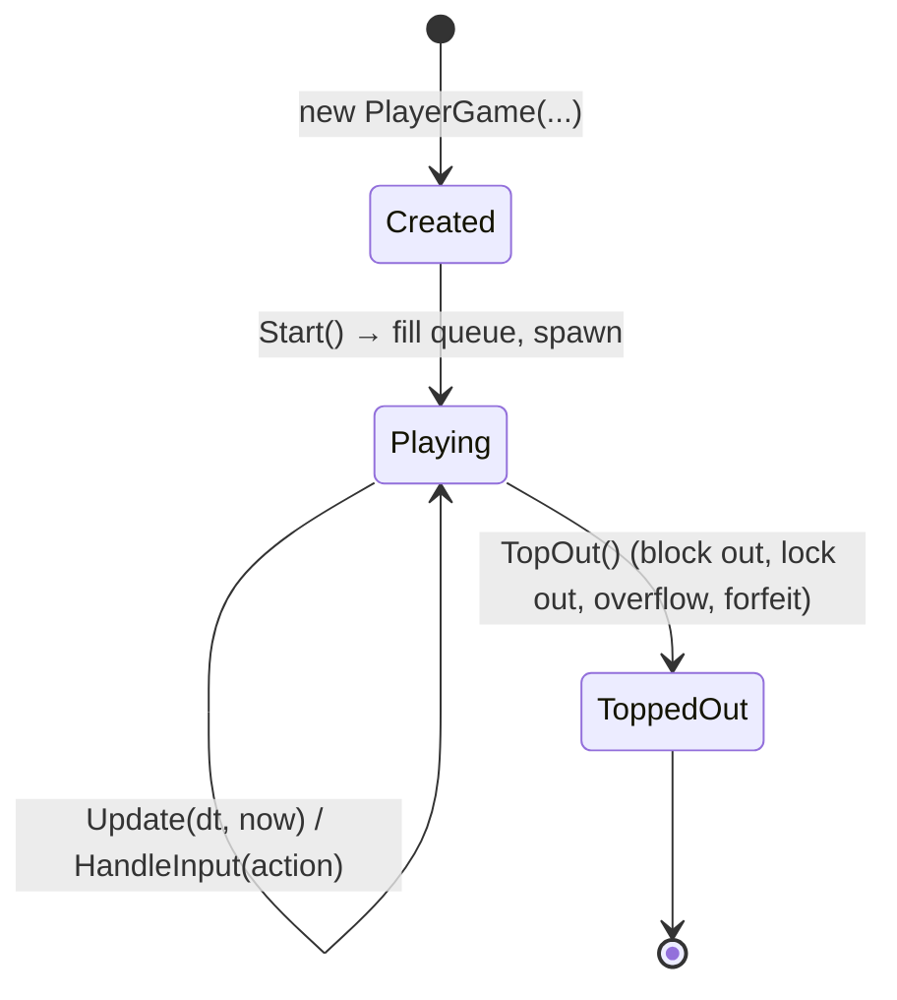

# Server (`actionBlocks_server/`)

ASP.NET Core 10 solution `ActionBlocks.Server.sln` with three projects:

```
actionBlocks_server/
├── src/ActionBlocks.Game/           # game rules – no web dependencies
│   ├── Core/
│   │   ├── PieceType.cs             # enum I,J,L,O,S,Z,T (value = color 1-7) + CellColor
│   │   ├── Cell.cs                  # Cell(Color, ItemId?) and Point(X, Y)
│   │   ├── PieceDefinitions.cs      # shapes + derived rotation states
│   │   ├── Piece.cs                 # PieceSpec (shape + item) and ActivePiece (spec + position)
│   │   ├── Board.cs                 # grid of locked cells, line clears, garbage, swap
│   │   ├── RotationSystem.cs        # IRotationSystem + SuperRotationSystem (kick tables)
│   │   └── Randomizer.cs            # IRandomizer + SevenBagRandomizer
│   ├── Garbage/GarbageCalculator.cs # ClearInfo, IGarbageCalculator, IScoreCalculator
│   ├── Targeting/GarbageTargeter.cs # IGarbageTargeter + CyclingGarbageTargeter
│   ├── Items/
│   │   ├── IItem.cs                 # IItem + ItemContext
│   │   ├── Items.cs                 # the five item implementations
│   │   └── ItemRegistry.cs          # ItemRegistry (list of items) + ItemSpawner
│   ├── GameSettings.cs              # all tunable numbers
│   ├── PlayerGame.cs                # one player's simulation + InputAction enum
│   └── Match.cs                     # one round: players, garbage/item routing, winner
├── src/ActionBlocks.Server/         # web host
│   ├── Program.cs                   # DI, CORS, SignalR, endpoints, config
│   ├── Hubs/GameHub.cs              # SignalR API for clients
│   ├── Lobbies/Lobby.cs             # one lobby (players, host, current match)
│   ├── Lobbies/LobbyManager.cs      # all lobbies, codes, connection→lobby mapping
│   ├── Lobbies/MatchRunner.cs       # BackgroundService: 60 Hz tick + broadcast
│   ├── Dtos/Dtos.cs                 # records sent over the wire
│   ├── Dtos/SnapshotMapper.cs       # game objects → DTOs
│   └── appsettings.json
└── tests/ActionBlocks.Game.Tests/   # xUnit tests
```

---

## ActionBlocks.Game – the rules library

### Coordinates

- **x** grows to the right, **y** grows **downwards**.
- `Board` has `Height = VisibleRows + BufferRows` rows (40 by default).
- Row `0` is the top of the hidden buffer. The visible field is rows `BufferRows … Height-1`, which is 20–39 by default.
- Piece shapes are offsets inside a square bounding box (2×2, 3×3 or 4×4). `ActivePiece.X/Y` is the board position of the box's top-left corner.
- Network DTOs convert to **visible coordinates** (`y - BufferRows`), so clients see y = 0 at the top of the visible field. Active-piece cells can have negative y while they are still in the buffer.

### Cells and pieces

```csharp
readonly record struct Cell(byte Color, string? ItemId = null)  // Color 0 = empty, 1-7 pieces, 8 garbage
sealed record PieceSpec(PieceType Type, string? ItemId, int ItemMinoIndex)  // what sits in the queue
sealed record ActivePiece(PieceSpec Spec, int X, int Y, int Rotation)     // a spec placed on the board
```

The item belongs to a **mino index** (0–3), not to a position. `PieceDefinitions` computes every rotation state by rotating the spawn shape mino by mino, so mino *i* is always the same physical cell of the piece. That keeps the item attached to the right block through every rotation. The website's preview shapes (`src/render/shapes.ts`) use the same mino order.

### `Board`

Holds the rows as `List<Cell[]>`, which makes shifting rows cheap. Main operations:

| Method | Purpose |
|---|---|
| `Fits(piece)` / `IsBlocked(x, y)` | Collision checks. Outside the board counts as blocked. |
| `Place(piece)` | Writes the piece's cells, including its item, into the grid |
| `FullRows()` / `ClearRows(rows)` | Line clear. Returns the item ids of removed cells |
| `AddGarbage(count, hole)` | Pushes rows in from the bottom. Returns `true` when blocks overflow the top (top out) |
| `RemoveBottomRow()`, `Clear()` | Used by items |
| `SwapContents(other)` | Exchanges the row lists of two boards (Switch item) |

### `PlayerGame` – one player's field

This is the heart of the simulation. Its lifecycle:



- **`Update(dt, now)`** is called every tick. It applies gravity (a fractional row counter `_gravityProgress`) and runs the lock-delay timer. Then it locks if needed.
- **`HandleInput(action)`** handles movement, rotation, soft-drop on/off, hard drop and hold. `UseItem` is ignored here, because using an item needs a target. `Match` handles it.
- **`Lock()`** is the central routine. It detects spins, places the piece, checks lock-out, clears rows and collects items. It also updates combo, back-to-back, score and level. Then it calculates the attack, cancels pending garbage and queues the remainder in `_outgoingAttacks`. If no line was cleared, it applies pending garbage. Finally it spawns the next piece.
- **Garbage in:** `QueueGarbage(lines)` adds to the pending list. **Garbage out:** `DrainOutgoingAttacks()` is read by `Match`.
- **Item hooks:** `InsertGarbageNow`, `RemoveBottomLine`, `ClearBoard`, `SwapBoards`, `InvisibleUntil`. After any board change under the active piece, `ResolveActiveOverlap()` pushes the piece up until it fits. If it can't fit anywhere, the player tops out.
- **Inventory:** `AddItem` (capped), `TakeFirstItem` (FIFO).

Dependencies are injected through the constructor (`IRandomizer`, `ItemSpawner`, `IRotationSystem`, `IGarbageCalculator`, `IScoreCalculator`, `Random`), so tests can control every source of randomness. See `tests/.../TestHelpers.cs`.

### `Match` – one round

- **Constructor.** It creates one `PlayerGame` per player. All of them share one piece seed, so everyone gets the same sequence. Each player gets its own `Random` for items and garbage holes. The match starts in `Countdown`, or directly in `Running` when `CountdownSeconds == 0`, which tests use.
- **`Update(dt)`** advances the countdown, or updates all players and then runs `AfterStateChange()`.
- **`HandleInput(playerId, action)`** is ignored unless the match is running and the player is alive. `UseItem` is resolved here. Then `AfterStateChange()` runs.
- **`SelectTarget(playerId, targetId)`** stores the target on the `PlayerGame`. An invalid or dead target becomes the player themself.
- **`Forfeit(playerId)`** is used when a player disconnects.
- **`AfterStateChange()`** routes every outgoing attack through the `IGarbageTargeter`, assigns places to newly eliminated players, resets targets that point at dead players, and detects the end of the match.
- **Events.** `ItemUsedEvent(TargetId, ItemId, ItemName)` and `PlayerEliminatedEvent(PlayerId, Place)` are collected and drained once per tick by the host.

### Items

```csharp
public interface IItem
{
    string Id { get; }            // stable id shared with the frontend ("add_line", ...)
    string DisplayName { get; }   // shown in the flash
    int SpawnWeight => 1;         // relative spawn probability
    void Apply(ItemContext context);
}
public sealed record ItemContext(PlayerGame User, PlayerGame Target, Random Random, double Now);
```

- `ItemRegistry.Default` lists all active items. `ItemRegistry.PickRandom` chooses an item weighted by `SpawnWeight`.
- `ItemSpawner.Decorate(type)` turns a raw piece type into a `PieceSpec`, sometimes with an item.

See [Extending → Add an item](extending.md#add-a-new-item).

### `GameSettings`

`GameSettings` is an immutable record with `init` properties, one per tunable number. See [Game rules](game-rules.md) for what each one does. The host binds it from the configuration section `Game`, so you can override any property with an environment variable named `Game__<PropertyName>`, e.g. `Game__ItemSpawnChance=0.25`.

---

## ActionBlocks.Server – the host

### `Program.cs`

- Reads the configuration: `ALLOWED_ORIGINS`, `HUB_PATH` (default `/hub`), `PATH_BASE` and the `Game` section.
- **CORS.** It allows the listed origins, or any origin when the list is empty, and allows credentials, which SignalR needs.
- **SignalR** uses JSON with `JsonStringEnumConverter`, so `InputAction` travels as a string like `"HardDrop"`.
- **Singletons:** `GameSettings` and `LobbyManager`. Hosted service: `MatchRunner`.
- **Endpoints:** `GET /health` returns `{"status":"ok"}`, and the hub is mapped at `HUB_PATH`.
- `UsePathBase(PATH_BASE)` lets the app accept requests that still carry a proxy prefix. Requests without the prefix work too.

### `LobbyManager`

- `_lobbies` maps lobby codes to `Lobby` objects. `_connectionLobby` maps each SignalR connection id to a lobby code. One connection can be in at most one lobby.
- **Codes** are 6 characters from `ABCDEFGHJKLMNPQRSTUVWXYZ23456789`. Ambiguous characters (0/O, 1/I) are excluded, and codes come from a cryptographically secure RNG. Joining is case-insensitive.
- **Names** are trimmed, control characters are removed, and they are cut to 16 characters. An empty name becomes `Player N`.
- **Player ids** are random 12-hex-character strings. They are deliberately **not** the connection id, so a connection id never leaks to other clients.
- `Leave` removes the player, and deletes the lobby once it is empty.
- Failures throw a `LobbyException`. The hub turns it into a `HubException` whose message reaches the client.

### `Lobby`

- `Players` and `HostId` are tracked; the first player is the host. If the host leaves, the next player becomes host.
- `MaxPlayers = 8`.
- `StartMatch(settings)` creates a `Match` from the current players. `EndMatch()` stores `LastResults` and clears `Match`.
- `Dirty` is set by input so that the next tick broadcasts immediately.
- `Remove(player)` also forfeits the player in a running match.
- `ToDto()` builds the `LobbyDto`.

### `GameHub`

The client API. It is documented in detail in [Protocol](protocol.md). Every method that touches a lobby locks `lobby.Sync`. `OnDisconnectedAsync` treats a disconnect exactly like `LeaveLobby`.

### `MatchRunner`

A `BackgroundService` with a `PeriodicTimer` at 60 Hz. Every tick:

1. Measures the real elapsed time and clamps it to at most 0.1 s, so a stall doesn't cause huge jumps.
2. For each lobby with a match, inside the lock: `match.Update(delta)`, then `DrainEvents()`.
3. Builds a snapshot when any of these holds: it is an even tick (≈30 Hz baseline), the lobby is dirty (input happened), or events are present. Building a snapshot whenever events exist means no event is ever dropped.
4. Once the match is finished, it waits `ResultsDelay` (4 s), then calls `lobby.EndMatch()` and broadcasts a `LobbyUpdated`.
5. Sends happen outside the lock, fire-and-forget.

Exceptions inside one lobby are logged and do not affect other lobbies.

### DTO mapping

`SnapshotMapper` converts a `Match` into a `MatchStateDto`:

- Only the visible rows are sent.
- The board becomes a compact string with one character per cell.
- Item cells are listed separately.
- The active piece and the ghost are omitted for eliminated players.

The format is in [Protocol](protocol.md).

---

## Tests

`tests/ActionBlocks.Game.Tests` (xUnit) covers:

| File | Covers |
|---|---|
| `CoreTests.cs` | Rotation states, wall kicks, bag randomizer, row clearing with items, garbage insertion |
| `PlayerGameTests.cs` | Spawn and gravity, line clears collecting items (from the board and from the piece), hold, pending garbage, attack size, top out, inventory cap |
| `ItemAndMatchTests.cs` | Each item's effect, Switch overlap resolution, Blackout duration, item use routed through `Match` with events, winner and places, target fallback, garbage cycling, countdown |

`TestHelpers.CreatePlayer(...)` builds a `PlayerGame` with a fixed piece sequence (`FixedRandomizer`) and a configurable item chance. `FillRow(board, y, holes...)` prepares board states.

Run them with `dotnet test` in `actionBlocks_server/`. The Docker build also runs them, so a failing test fails the image build.
